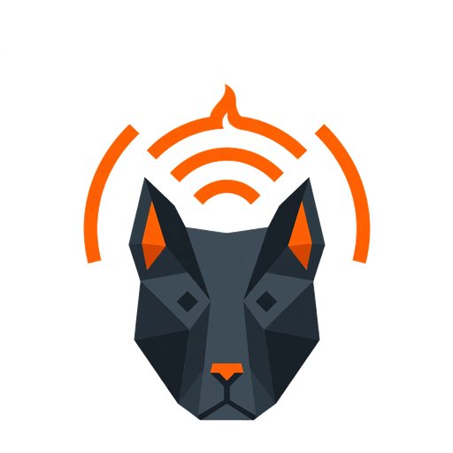

<p align="center">
  
</p>

# FlareHound

English | [中文](README.zh.md)

**A self-hosted traffic console and watchdog for websites behind Cloudflare.** It polls the Cloudflare Analytics API with a read-only token, detects traffic anomalies hour by hour, breaks them down by path / ASN / user agent / cache status, and sends you a short, plain-language report — conclusion first, with the evidence and a suggested action — only when something actually needs your attention.

Cloudflare gives you data. FlareHound gives you the conclusion.

> Status: **v1.16.0** — expired blocks lifted by the console; block rules placed after skip rules and ahead of challenges, with a bypass warning at review; live 15-minute check per block and approximate attempts on Free; Worker CPU alerts check themselves (P50 vs P99 vs calls); origin view for VPS sites behind the proxy (origin unreachable 52x, origin latency P95, 5xx rate and status split); IP board (who keeps hitting, last hour and 24 h; verified bots folded, ranges summed), client IPs in the drill-down; "what is rising now": blocked board, trend strip vs yesterday, live faces; e-mail over HTTPS (Resend) where SMTP is blocked; per-zone WAF audit coverage; cross-zone home, block verdicts in the daily report, rule-covered faces marked, audit/rule snapshots; settings in the console (notifications with test sends, alert lines with a replay preview, known faces, network names); console in English or Chinese; WAF basics, rule recipes and plain-words rules; live hour and movers drill-down; web console with in-console blocking, undo, before/after, read-only snapshots and Google / GitHub sign-in; mark-as-known as a compact link. Documentation: **https://playwjj.github.io/flarehound/** · Changelog: [CHANGELOG.md](CHANGELOG.md)
>
> **Direction:** the built-in web console (since v1.3) is the centre of the product — live movers, new faces, history against the long-term baseline, the WAF audit and rules, settings, and in-console blocking with per-account audit. Notifications are the alerting layer that brings you to the console. See the [web console revision note](docs/web-console-revision.md).
>
> The detection model, thresholds and alert discipline are ported from a real incident response (a residential-proxy crawler flood, 2026-11-17).

## Why

- A crawler flood can start at 08:00 and burn Workers CPU for hours before a daily summary — or the invoice — shows it.
- Cloudflare's own smart anomaly tooling mostly lives on Enterprise plans. Pro / Business / Free users get raw dashboards.
- Generic uptime monitors check *whether* your site is up, not *what your traffic is doing*.

FlareHound watches the traffic itself:

- **Hourly anomaly watch** — the last full clock hour vs. the same hour yesterday: zone requests, uncached (`dynamic`) responses, origin 5xx, origin reachability and latency (for sites on a VPS behind the proxy), Worker invocations and CPU P50.
- **Attribution before conclusions** — every spike is split by path, ASN, user agent and cache status first, and "expensive" traffic (Worker renders, origin hits) is reported separately from cheap edge volume.
- **New-face detection** — user agents and ASNs that suddenly enter your Top 10 and weren't in yesterday's Top 25.
- **Alive, provably** — every round writes a heartbeat (file, JSONL, optional healthchecks.io-style ping) and the container has a `HEALTHCHECK`, so a dead watchdog never looks like a quiet site.
- **Quiet by design** — no anomaly, no message. The same anomaly never alerts twice unless it grows another 25%; two clean rounds earn a single "recovered" line.
- **Suggestions, never actions** — the watchdog core is read-only. It may suggest blocking an ASN or challenging a path, with evidence and expected impact, but it never changes your Cloudflare configuration. Acting on a finding — blocking an IP, range, ASN, country or user agent, or applying a rule change — is a separate, explicitly confirmed command behind its own write token; the watchdog itself never holds that token.
- **A memory Cloudflare doesn't keep** — Cloudflare retains only ~31 days of analytics, and raw logs are a metered add-on. FlareHound snapshots every check into a local SQLite file (`data/archive.db`, ~13 months of hourly snapshots, daily rollups forever), building the long memory the platform lacks. Once four weeks are archived, a spike must beat both yesterday *and* the 4-week same-hour median before it alerts — one odd yesterday no longer pages you. New ASNs and user agents are reported with their first-seen date, and every alert is kept in a history table.

## Quick start

Releases are published to Docker Hub as multi-arch images (`linux/amd64`, `linux/arm64`) on every `v*` tag, e.g. `passport888/flarehound:1.12.0`. The `docker-compose.yml` in this repo pulls the published image (or builds it locally from source if you prefer).

```bash
docker compose up -d
```

1. Create a **read-only** Cloudflare API token (see below).
2. Copy `config.example.json` to `config.json`, fill in your zone ID and Worker names.
3. Put the token in the environment — never in the config file:

```bash
export CF_API_TOKEN=...
```

4. Point `notify.webhook_url_env` at an environment variable holding any endpoint that accepts a JSON POST (Telegram/Slack/Discord bridges included), or configure the Telegram bot.
   Native channels (v0.8): **Slack**, **Discord**, **WeCom** (企业微信), **Feishu/Lark** (飞书, optional signing secret) and **email** (SMTP with STARTTLS or TLS, or Resend's HTTPS API where SMTP ports are blocked) — set `notify.slack_webhook_url_env`, `discord_webhook_url_env`, `wecom_webhook_url_env`, `feishu_webhook_url_env` (+ `feishu_secret_env`), or a `notify.email` block; every URL and password comes from an environment variable. Long reports are split to each service's size limit, and bot errors returned inside an HTTP 200 count as failures (retried, then queued).
   To feed alerts into your own tooling instead, set `notify.jsonl_file` (e.g. `data/alerts.jsonl`): every message is appended as one JSON line with `kind`, `zone`, `decision`, the window, the fired `rules` and the `text`.
5. Pick the report language: `"report": {"language": "en"}` or `"zh"` (Chinese).

Optionally fill the local archive with the last four weeks right away (Cloudflare keeps ~31 days), so the 4-week baseline works from day one instead of week five. It is paced to ~1 query/second and takes about an hour per zone:

```bash
flarehound -config config.json -backfill 28
```

Check the installation — what each token can do, with any missing permission named:

```bash
flarehound -config config.json doctor
```

Try it before going live — this prints the messages instead of sending them:

```bash
flarehound -config config.json -once -dry-run    # one hourly check
flarehound -config config.json -daily -dry-run   # today's daily report
```

### What a message looks like

```
FlareHound · example.com — anomaly
Worker web calls +52.0%, Worker web CPU P50 +50.0%, dynamic +75.0%, zone requests +52.0% (+1 more)
Window 2026-11-17 08:00–09:00 (Asia/Shanghai)

Attribution:
- expensive (Worker/origin) 40,000 → 70,000 (+30,000); cheap (edge cache) 60,000 → 82,000 (+22,000)
- top dynamic paths: /rank 35,000 (was 20,000)
- AS207990 hits: /rank 35,000

Hypotheses:
- [high] Crawler/bot surge: new source AS207990 carries ~87% of the excess.
  Falsified if its path mix matches normal visitors and it comes from residential/mobile networks …

Sources are dispersed (top IP < 1% of the excess): per-IP blocking will not help — act at ASN or path level (challenge).

Suggestions (read-only — FlareHound never applies them; do it in the Cloudflare dashboard):
1. Block AS207990 (EXAMPLE-HOSTING-AS, hosting network)
   where: Security → WAF → Custom rules, action Block
   expression: (ip.geoip.asnum in {207990}) and not cf.client.bot
   why: 45,000 requests vs 0 yesterday, ~87% of the excess; a hosting network, where no human visitors are expected.
   gain: ~45,000 fewer requests per window, of which ~20,723 expensive (estimate)
   impact: anything legitimately running on that network (your own monitors, partner APIs, uptime checkers) is blocked too; …
   rollback: disable or delete the rule (takes effect in seconds)
```

**Suggestions** come with evidence, expected gain, blast radius, rollback and a paste-ready rule expression. Only cloud/datacenter ASNs are ever suggested for blocking; residential, mobile, backbone and unknown networks get a *challenge* suggestion instead. No suggestion is made when the evidence is thin, or when the surge is mostly cheap edge-cached traffic.

### Token permissions (read-only)

Create the token at *Cloudflare Dashboard → My Profile → API Tokens → Create Token → Custom token*:

- **Zone** → **Analytics: Read** (for each zone you monitor) — the only permission the watchdog needs.

Optional add-ons — grant only when you enable the feature:

- **Worker metrics** (`workers` listed in the config): add **Account** → **Account Analytics: Read**.

- **WAF rule audit** (v0.6): add **Zone** → **WAF: Read** to the same token (optionally **Zone: Read** for the quota check).
- **One-click blocking** (v0.5) and **rule changes** (v0.7): create a *separate* write token — **Account** → **Account Filter Lists: Edit**; **Zone** → **WAF: Edit** (custom rules; IP Access Rules too on some accounts), **DNS: Read**, **Zone: Read** (+ **Cache Rules: Edit** for cache rules). Put it in `CF_WRITE_TOKEN`. Never merge it into the read token; the watchdog process never holds it.

Permission names: custom rules always need **Zone → WAF**. IP Access Rules vary by account — covered by Zone → WAF on some, **Firewall Services** on others, not grantable on some; they are optional and FlareHound degrades without them. `flarehound doctor` shows what your tokens can actually reach.

The watchdog makes GraphQL Analytics calls only (`api.cloudflare.com/client/v4/graphql`), which is why Analytics: Read is enough; older versions of this README also asked for Logs, Zone and Workers Scripts read access, which no code path uses. (This minimum is derived from the code's call sites; a quick check with your own token: create one with only Zone → Analytics: Read and run `flarehound -once -dry-run`.) The audit will additionally read rulesets through the REST API on the same host. Your token never leaves your machine and is never written to disk or logs by the program.

## Web console

```bash
# config.json: "console": {"enabled": true}
flarehound -config config.json console init-admin --user you   # or use the one-time setup link it logs
flarehound -config config.json console                         # http://127.0.0.1:8640
```

A separate process from the watch, reading the same archive: the newest hour against the 28-day baseline, biggest risers and fallers by user agent / ASN / uncached path, new faces, history with alerts and blocks on a timeline, the WAF audit and the block list. Built for a phone first. Accounts (admin / viewer) with TOTP; it binds to loopback — reach it through Tailscale, a TLS reverse proxy or Cloudflare Tunnel.

Give the write token to the console process (never the watch) and admins block from it: prefilled from the movers, the same guard rails and review as the CLI, a fresh two-factor code per change, audit under the account before anything is touched, read-back, one-click undo and an automatic before/after comparison. Any view can be frozen into a read-only snapshot with an expiring, revocable share link. People can also sign in with Google or GitHub once they have linked it to their account. See [docs/console.md](docs/console.md).

With several zones, the home page lists them all, ranked by which needs attention first. Settings live in the console as well — notification channels with test sends (sent by the watch, with its own environment), alert lines previewed against the last 7 days before they apply, known faces and per-ASN network names — and the console speaks English or 中文. Forgotten passwords can be reset by e-mail when mail (SMTP or Resend) and a public base URL are configured.

## One-click blocking

Alerts name the culprit and print the command that blocks it:

```bash
flarehound block asn 207990 --action block --for 24h
flarehound block ip 45.13.7.9
flarehound block country XX --action challenge
flarehound block ua "BadBot/1.0" --for 7d --reason "scraper, 11-17 incident"
flarehound unblock asn 207990
flarehound blocks            # everything blocked, with 7-day attempts and expiry
flarehound enforce           # optional: lifts expired blocks without a console
```

Before anything changes you see the exact plan — the rule it edits and the expression afterwards, the custom-rule quota, the target's measured share of the last hour's excess, and every warning — and confirm once. FlareHound only ever edits its own objects (rules named `flarehound-…`, the IP list `flarehound_block`), merges each target type into one rule so your quota is barely touched, keeps verified search bots allowed on ASN and country rules, and reads the result back to verify. It refuses to block Cloudflare's ranges, your origin IPs (from DNS), private ranges and anything on your `blocking.never_block` list. Blocking a residential/backbone ASN or a whole country requires retyping the ASN or country code. Every action lands in an append-only audit log, and the daily report lists each block's attempts — lift a block when the attempts stop, not when it gets quiet.

A console holding the write token lifts expired blocks itself (every 5 minutes); without a console, run `flarehound enforce` — in Docker `docker compose --profile admin up -d` starts it with the write token, and `docker compose run --rm flarehound-admin block …` runs commands.

## WAF basics and recipes

New to WAF rules? [WAF basics](docs/waf-guide.md) ([中文](docs/waf-guide-zh.md)) covers order, verified bots, block vs challenge and narrow skips, and the recipes do it for you:

```bash
flarehound rules recipes
flarehound rules recipe protect-paths --path '/login*, /admin*'
flarehound audit          # ends with "How to fix"
```

Every rule is explained in plain words (`flarehound rules list`, the console's WAF rules page), and every change is shown in full, confirmed, backed up and read back.

## Applying rule changes

Suggestions that are rule changes come with the command that applies them, and you can manage custom, rate-limit and cache rules directly:

```bash
flarehound rules list [--phase custom|ratelimit|cache]
flarehound rules add --action managed_challenge --expr 'starts_with(http.request.uri.path, "/login")' --desc "challenge login" [--before 1]
flarehound rules edit 3 --enabled false
flarehound rules move 3 --before 1        # or --last
flarehound rules delete 3
flarehound ratelimit add --path '/rank' --requests 20 --period 10
flarehound cache add --path '/assets/*' --ttl 1d
flarehound rules backups                   # snapshots taken before each change
flarehound rules restore 12                # put a phase back as it was
flarehound rules log                       # who changed what, verified or not
```

Every change is shown in full (field-by-field old → new for edits), confirmed by you — there is deliberately no `--yes` — backed up first (to the archive and to `data/backups/<zone>/*.json`), read back and compared field by field and by position, and appended to an audit log. Expressions are syntax-checked locally before they are sent; quotas are checked per plan; rules owned by the blocking module are off limits. Cache rules additionally need **Zone → Cache Rules: Edit** on the write token.

## WAF rule audit

`flarehound audit` (and a section of every daily report) reads your custom rules — read-only — and checks them like a reviewer would:

- **Coverage gaps**: is each sensitive path (`path_rules`, `daily.paths`, `waf_audit.sensitive_paths`, or the zone's own `zones[].waf_audit.sensitive_paths`) covered by a block/challenge rule? Fully, only conditionally (e.g. only for one user agent), or not at all — or exempted by a skip rule placed ahead of it.
- **Ordering**: rules that can never fire because an earlier Block rule already matches everything they match, exact duplicates, and protections a skip rule ahead of them lets traffic around.
- **Exemptions**: skip rules whose condition uses only fields any client can forge (user agent, referer, path…) — "anyone who sends `MyMonitor` in the UA skips your WAF".
- **Hits and zombies** (plans with firewall events): 7- and 30-day hits per rule; rules with no hits in 30 days are reported (not removed — quiet is not useless).
- **Quota**: near the plan's custom-rule limit, which rules can be merged.

It ships its own parser for the Cloudflare rules language and evaluates rules with three-valued logic against probe requests, so it only claims what it can show. When the ruleset version changes, the next hourly round re-audits and reports any problem.

## Calibration: why FlareHound's numbers differ from the dashboard

FlareHound reads Cloudflare's *adaptive* analytics, which are sampled and also count Worker subrequests and cache operations; the dashboard does not. Expect FlareHound to count more — on a live zone ≈ 1.29× the dashboard's requests. All thresholds are in FlareHound's units. `flarehound calibrate --days 7` shows the ratio per day (requests, cache hits, edge 5xx, sampling) and what `min_count` means in dashboard terms; every daily report carries a one-line ratio.

## How it decides

Default alert lines (all configurable — these are the battle-tested values from the incident the tool is based on):

| Signal | Default |
|---|---|
| Worker invocations vs. yesterday | +35% |
| Zone requests vs. yesterday | +35% |
| Worker CPU P50 vs. yesterday | +25% |
| Dynamic (uncached) responses vs. yesterday | +50% |
| Origin 5xx | 3× baseline **and** > 50 |
| Origin unreachable (edge 52x) | ≥ 10 per hour (a healthy origin has none) |
| Origin latency P95 (first byte) | +100% **and** ≥ 1 s |
| New face in Top 10 (UA or ASN) | > 5,000 requests/hour |
| Collapse in requests or invocations | −50% (re-read after 3 min; still-arriving data is never called a collapse) |
| Volume floor for percentage rules | 1,000 requests per window |

Per-path overrides (`path_rules`) put a tighter line on sensitive low-volume paths like `/login*`.

Known false-positive class handled out of the box: legitimate crawlers (Googlebot, Bingbot, Applebot, YandexBot, Baiduspider) bump their user-agent version strings and trip "new face" — FlareHound checks that ≥ 90% of that UA's traffic comes from the crawler's own ASN before excluding it, so impostors still alert. Register your own monitors and services under `known_faces`.

**Alert discipline:** one alert when an anomaly starts; one more only if it shows a *new* signal or a reported signal grows another 25%; one line when two clean rounds pass. Failed deliveries are retried 3 times and then queued on disk for the next round.

**Daily report** (default 08:00 local): last 24 h vs the 24 h before, cache-cost split, top paths / ASNs / user agents with new ones marked, firewall events per rule, and your fixed checkpoints (`daily.paths` origin-reach limits, `daily.artifacts` known accounting artifacts).

## Deployment

The primary form factor is a single Go binary in a Docker container, running on **your own** VPS, home server or NAS — deliberately *not* on Cloudflare itself, so the watchdog has no blind spot when the platform it watches is the thing in trouble. The engine only needs outbound HTTPS and a local state file; a Cloudflare Workers (Cron Triggers) deployment adapter is on the roadmap as an alternative.

## Roadmap

- ~~v0.2~~ — daily digest (24 h comparison + fixed checkpoints) ✅
- ~~v0.3~~ — full intraday watch (new-face detection, escalation/recovery state machine, attribution queries) ✅
- ~~v0.4~~ — suggestion engine (block / challenge / rate-limit / cache candidates) + local SQLite archive ✅
- ~~v0.5~~ — one-click blocking (IP / CIDR / ASN / country / user-agent — block from an alert or the CLI, expiring blocks, guard rails, audit log) ✅
- ~~v0.6~~ — WAF rule audit (coverage gaps on sensitive paths, ordering/redundancy issues, per-rule hit stats, over-broad exemptions) ✅
- ~~v0.7~~ — general action module (execute approved suggestions with a separate write token, pre-change backup, read-back verification) ✅
- ~~v0.8~~ — more notification channels (Slack, Discord, WeCom, Feishu, email), parallel multi-zone checks ✅
- ~~v1.0~~ — calibration against the dashboard (`flarehound calibrate`), documentation site, first stable release ✅

- ~~v1.3~~ — read-only web console (overview vs baseline, movers, new faces, history, WAF audit, blocks) with built-in accounts and two-factor sign-in ✅
- ~~v1.4~~ — blocking from the console (write token only in the console process, guard-rail confirmation, before/after effect, undo, read-only snapshots) ✅
- ~~v1.5~~ — Google / GitHub sign-in bound to local accounts ✅
- ~~v1.7~~ — WAF basics and rule recipes, plain-words rule explanations; live hour and movers drill-down; TOTP setup by QR code and password reset by e-mail ✅
- ~~v1.8~~ — console language switch (English / 中文) ✅
- ~~v1.9~~ — settings in the console (notifications with test sends, alert lines with a replay preview, known faces) and network names ✅
- ~~v1.10~~ — cross-zone home, block verdicts, rule-covered faces marked, snapshots of the WAF audit and the rules ✅
- ~~v1.11~~ — WAF audit coverage per zone (each zone's own hosts and sensitive paths) ✅
- ~~v1.12~~ — e-mail over HTTPS (Resend) where outbound SMTP is blocked ✅


## Limitations

- Cloudflare's GraphQL Analytics is sampled and has no referer dimension; very large sites will find attribution too coarse. FlareHound targets small-to-medium sites.
- What analytics expose depends on the plan. FlareHound probes each zone at startup and degrades instead of failing: on **Free**, there is no ASN breakdown (new-ASN detection and ASN suggestions are off) and no firewall events (block attempts show "n/a"); crawlers are verified with Cloudflare's own `verifiedBotCategory` instead.
- Analytics ingestion lag (~5–10 min) sets the detection floor. This is a watchdog, not a real-time shield — edge rules remain the shield.
- The local archive stores hourly aggregates, not raw request logs; it cannot reconstruct individual requests, and history starts accumulating only from the day you deploy.
- No AI sits in the detection path: findings are deterministic and reproducible from the same data. An optional bring-your-own-key AI explainer that narrates findings is on the long-term roadmap — it will never gate, suppress or act on an alert.

## License

MIT © 2026 playwjj
